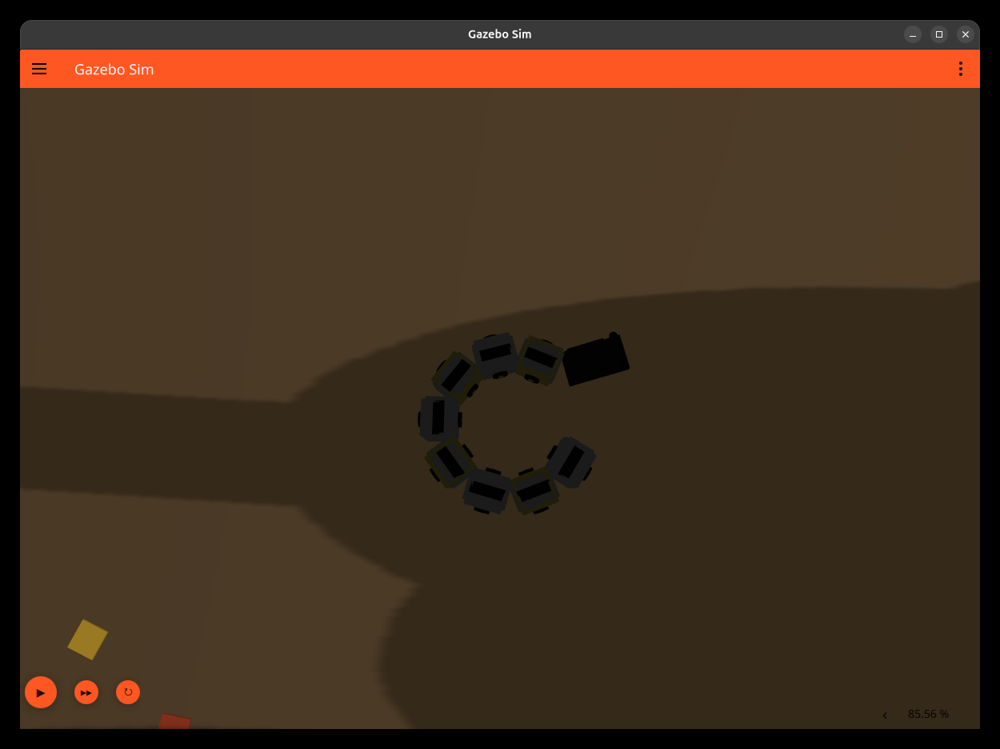
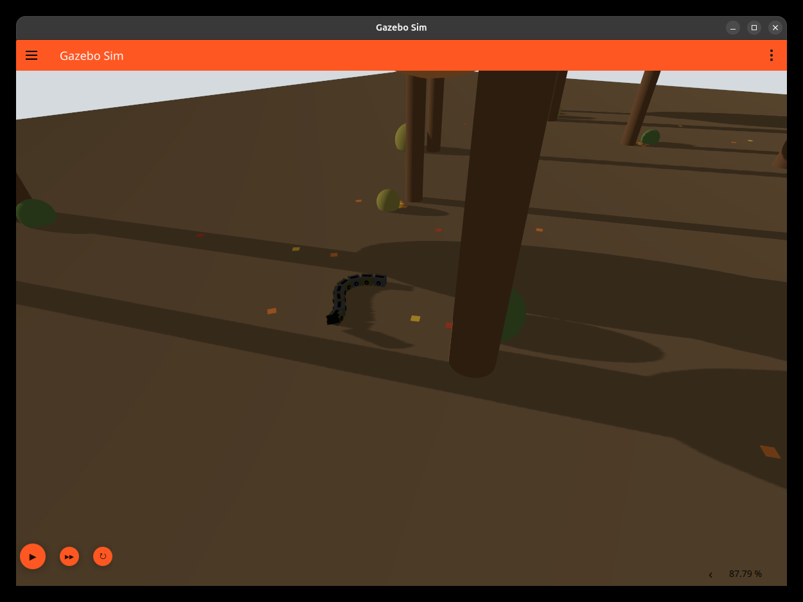

# Биомиметический змеевидный робот — ROS 2 / Gazebo

[中文说明](README.zh-CN.md) · [Полное руководство на русском](docs/guide.ru.txt) · [中文完整手册](docs/guide.zh-CN.txt)

Учебная модель змеевидного робота в **ROS 2 Lyrical / Gazebo Sim 10**: серебристо-золотистое тело, управляемые голова и язык, осенний лес, конечный автомат поведения, локальный обход препятствий и восстановление после застревания.

Видимая конструкция — **8 сегментов тела и голова**. С учётом шеи и языка URDF содержит **11 звеньев и 10 управляемых внутренних сочленений**. Общая масса модели — **8.003 кг**.

Общее движение задаётся плагином Gazebo `VelocityControl`, форма тела — траекториями сочленений. **Продвижение только за счёт трения тела о грунт пока не проверено.**

## Демонстрация

Реальные снимки предыдущего испытания **2026-11-03**, не новые результаты:





## Где смотреть код

| Что объясняется | Файл и ключевое место |
|---|---|
| Геометрия, масса, инерция, оси и пределы | [URDF/Xacro](src/snakebot_description/urdf/snakebot.urdf.xacro), `body_segment`, `box_inertia` |
| Подъём головы и язык | [URDF/Xacro](src/snakebot_description/urdf/snakebot.urdf.xacro), `head_pitch_joint`, `tongue_joint` |
| Генерация синусоидальных целей | [snake_behavior.py](src/snakebot_description/scripts/snake_behavior.py), `body_targets` |
| Непрерывная фаза при изменении частоты | [snake_behavior.py](src/snakebot_description/scripts/snake_behavior.py), `phase_at` |
| Проверка полного сообщения на 10 сочленений | [snake_behavior.py](src/snakebot_description/scripts/snake_behavior.py), `make_trajectory` |
| Состояния, сглаживание, язык | [behavior_core.py](src/snakebot_description/scripts/behavior_core.py), `Biology`, `Blend`, `FlickTrain` |
| Обход, прогноз, WRAP и восстановление | [behavior_core.py](src/snakebot_description/scripts/behavior_core.py), `Navigation` |
| Контроллеры | [controllers.yaml](src/snakebot_description/config/controllers.yaml) |
| Соединение ROS и Gazebo | [ros_gz_bridge.yaml](src/snakebot_description/config/ros_gz_bridge.yaml) |
| Последовательность запуска | [launch](src/snakebot_description/launch/snakebot_gazebo.launch.py) |
| Создание леса и соответствующей карты | [generate_forest.py](src/snakebot_description/tools/generate_forest.py) |
| Проверки алгоритмов и интерфейса | [tests](src/snakebot_description/tests) |

Нынешний launch запускает **`snake_behavior.py`**, который импортирует `behavior_core.py`. Старые `snake_wave.py` и `snake_roam.py` сохранены для истории и не запускаются одновременно с главным узлом.

## Алгоритм

Для восьми Z-сочленений:

```text
q_i(t) = c(t) + A(t) sin(phi(t) - (i-1) Delta), i = 1,...,8
phi(t) = phi_0 + 2 pi integral f(t) dt

Обычный режим: A = 0.4 rad, f = 0.7 Hz, Delta = 0.6 rad.
Сглаживание параметров: S(u) = 10u^3 - 15u^4 + 6u^5.
```

Каждые 0.02 секунды симуляции формируется полная траектория десяти сочленений. Общие `v` и `omega` передаются отдельно через `/cmd_vel`. Карта деревьев известна заранее; используются `/odom` и `/joint_states`, а не камера или SLAM.

| Состояние | Действие |
|---|---|
| ROAM | Волна 0.4 рад / 0.7 Гц и случайное перемещение |
| REST | Остановка на 2 с и небольшие колебания |
| ALERT | Подъём головы и 3–5 коротких движений языка за 2 с |
| LOW_CRAWL | Низкая голова, уменьшенная амплитуда и скорость |
| COILED | Плавное сворачивание с общим углом около 0.65 рад, 4–6 с |
| WRAP | Подготовка безопасного радиуса, 4 с движения по дуге, выход наружу |

Обычные переходы — 0.3 с; вход и выход COILED/WRAP — 1 с. WRAP не означает лазание или обязательный полный оборот. Застревание выявляется сравнением заданного пути и фактической одометрии за примерно 3 с.

## Запуск на исходном компьютере

Рабочее пространство с установленными зависимостями: `/data/ros2_ws`.

```bash
cd /data/ros2_ws
source /opt/ros/lyrical/setup.bash
source .venv/bin/activate
source install/setup.bash
ros2 launch snakebot_description snakebot_gazebo.launch.py
```

Для ручного управления сначала завершите предыдущую симуляцию, затем запустите:

```bash
ros2 launch snakebot_description snakebot_gazebo.launch.py autonomous:=false
```

В другом терминале с тем же окружением:

```bash
ros2 run key_teleop key_teleop --ros-args \
  -p use_sim_time:=false -p twist_stamped_enabled:=false -r key_vel:=/cmd_vel
```

Для начальной позиции у дерева, после завершения прежнего запуска:

```bash
ros2 launch snakebot_description snakebot_gazebo.launch.py \
  spawn_x:=-7.33535 spawn_y:=0.06207 spawn_yaw:=0.0
```

Проверьте контроллеры и обратную связь:

```bash
ros2 control list_controllers
ros2 topic echo /snakebot/behavior_state --field data --full-length --once
ros2 topic echo /joint_states --full-length --once
```

## Сборка после изменения исходников

В ROS-рабочем пространстве с этим пакетом и установленными зависимостями:

```bash
source /opt/ros/lyrical/setup.bash
source .venv/bin/activate
python3 -m unittest discover -s src/snakebot_description/tests -v
colcon build --packages-select snakebot_description
source install/setup.bash
```

**Перенос на другой компьютер:** `package.xml` перечисляет зависимости. В текущем launch и shebang скриптов сохранён абсолютный Python-путь `/data/ros2_ws/.venv/bin/python3`; при другом рабочем пространстве его необходимо адаптировать. Это снимок текущего проекта, не полностью переносимый установщик. Само чтение кода на GitHub не требует ROS или Gazebo.

## Документация и ограничения

- [Полное русское TXT-руководство](docs/guide.ru.txt): операции, код, формулы, сценарий выступления, вопросы преподавателя, все исходники с пояснениями.
- [中文 TXT 手册](docs/guide.zh-CN.txt).
- [История проверки и известные ограничения](docs/VALIDATION.md).
- [Контрольные суммы оригинального пакета](docs/source-snapshot.json).

Размеры, массы и ограничения приводов являются проектными допущениями. Самоколлизии отключены, ступицы декоративны. Сохранены известные проблемы: малое превышение команды языка у предела, ошибка завершения launch и уменьшение обычного DODGE коэффициентом LOW_CRAWL. Позиционный JTC не использует записанные gains как моментный PID.

Репозиторий предназначен для частного учебного показа. Преподавателю нужен доступ к частному репозиторию; одной ссылки для постороннего аккаунта недостаточно.

