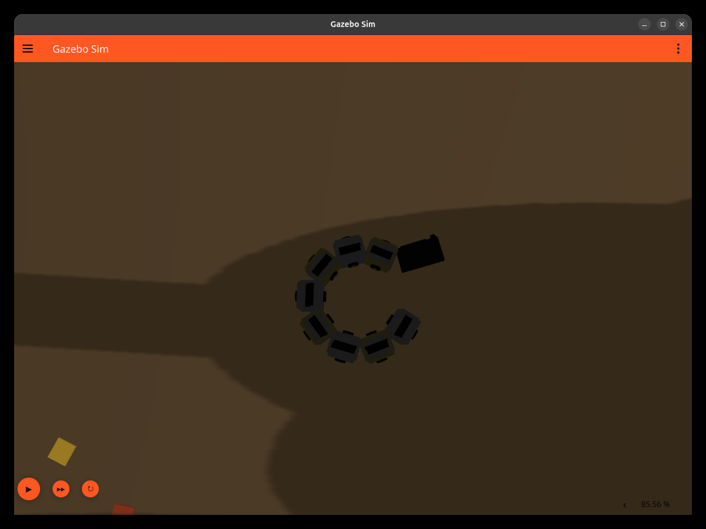

# 基于 ROS 2 与 Gazebo 的仿生蛇形机器人

[俄语首页](README.md) · [中文完整手册](docs/guide.zh-CN.txt) · [俄语完整手册](docs/guide.ru.txt)

本仓库用于给老师展示当前 `snakebot_description` 项目的代码、模型和控制算法。环境为 ROS 2 Lyrical / Gazebo Sim 10。

可见主体是 8 节身体和头部；计入辅助颈部与舌头，共 11 个 link、10 个内部受控关节，总质量约 8.003 kg。森林包含 32 棵树、32 丛灌木和 304 片落叶。

蛇身姿态由关节轨迹生成，整体移动由 Gazebo `VelocityControl` 设置速度。当前尚未验证仅靠身体摆动和地面摩擦产生推进的动力学模型。避障使用预先生成的地图、里程计和关节反馈，没有相机识别或 SLAM。

## 展示与代码阅读



截图来自 2026-11-03 历史测试，不代表本次重新完成了动作验收。

| 老师的问题 | 查看位置 |
|---|---|
| 机器人如何建模 | [Xacro](src/snakebot_description/urdf/snakebot.urdf.xacro)：`body_segment`、`box_inertia`、关节定义 |
| 如何生成蛇形动作 | [主节点](src/snakebot_description/scripts/snake_behavior.py)：`body_targets`、`phase_at` |
| 行为如何切换 | [算法核心](src/snakebot_description/scripts/behavior_core.py)：`Biology.TARGETS`、`Blend`、`FlickTrain` |
| 如何绕树和脱困 | 同文件 `Navigation`、`predicted`、`_track_motion`、`_wrap_command` |
| 关节如何执行 | [控制器](src/snakebot_description/config/controllers.yaml) 与 Xacro 的 `ros2_control` |
| 系统如何启动 | [launch](src/snakebot_description/launch/snakebot_gazebo.launch.py) |
| 森林如何生成 | [生成器](src/snakebot_description/tools/generate_forest.py) 与同源地图 |

当前只启动 `snake_behavior.py`，调用 `behavior_core.py`；旧 `snake_wave.py`、`snake_roam.py` 作为历史源码保留。

正常波形：`q_i = c + A sin(phi - (i-1) Delta)`，A=0.4 rad、f=0.7 Hz、Delta=0.6 rad。
轨迹发布 50 Hz、控制管理器配置 500 Hz；常规缓动 0.3 s，盘卷和绕树进出用 1 s。

## 在原电脑启动

```bash
cd /data/ros2_ws
source /opt/ros/lyrical/setup.bash
source .venv/bin/activate
source install/setup.bash
ros2 launch snakebot_description snakebot_gazebo.launch.py
```

手动遥控：先退出上一轮，用 `autonomous:=false` 重启。在另一已加载环境的终端执行：

```bash
ros2 run key_teleop key_teleop --ros-args \
  -p use_sim_time:=false -p twist_stamped_enabled:=false -r key_vel:=/cmd_vel
```

近树演示：先退出旧仿真，再执行：

```bash
ros2 launch snakebot_description snakebot_gazebo.launch.py \
  spawn_x:=-7.33535 spawn_y:=0.06207 spawn_yaw:=0.0
```

修改后测试与构建：

```bash
python3 -m unittest discover -s src/snakebot_description/tests -v
colcon build --packages-select snakebot_description
source install/setup.bash
```

命令需在已加载 ROS 与 Python 环境的工作空间执行。当前脚本及 launch 保留了 `/data/ros2_ws/.venv/bin/python3` 绝对路径，换电脑或工作空间时需适配，不能直接宣称已实现任意目录安装。

## 资料

- [中文完整操作与代码讲解 TXT](docs/guide.zh-CN.txt)
- [俄语完整操作与代码讲解 TXT](docs/guide.ru.txt)
- [历史验证与已知问题](docs/VALIDATION.md)
- [原始源码校验清单](docs/source-snapshot.json)

本仓库不包含 `my_test_pkg`、虚拟环境、构建产物、个人环境清单或原始运行日志。
私有仓库需要另外授予老师访问权限，老师才能打开链接。已知的舌头限位裁剪、退出异常、普通 DODGE 潜行倍率等问题保留说明，没有把历史结果包装成本次全部通过。

